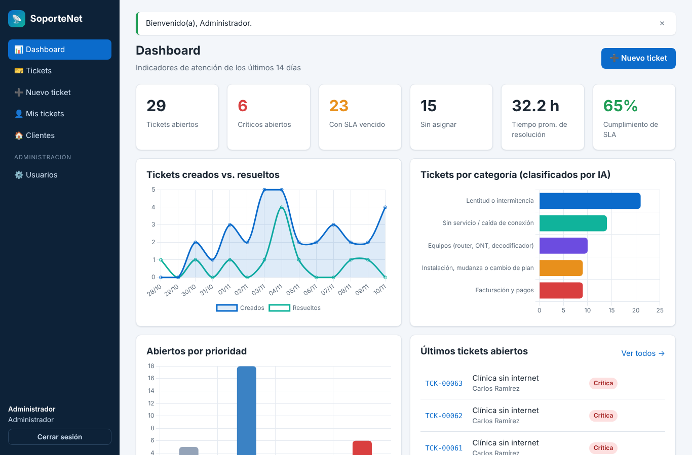
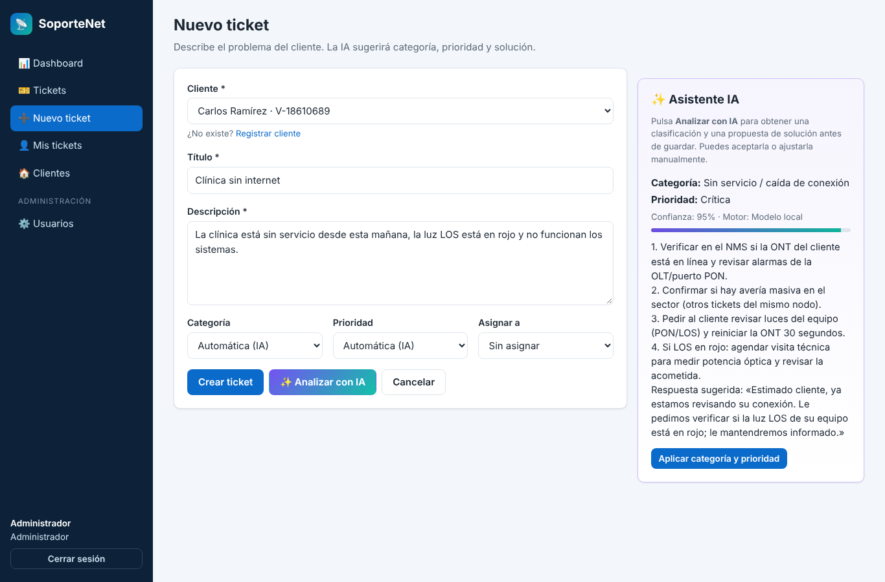
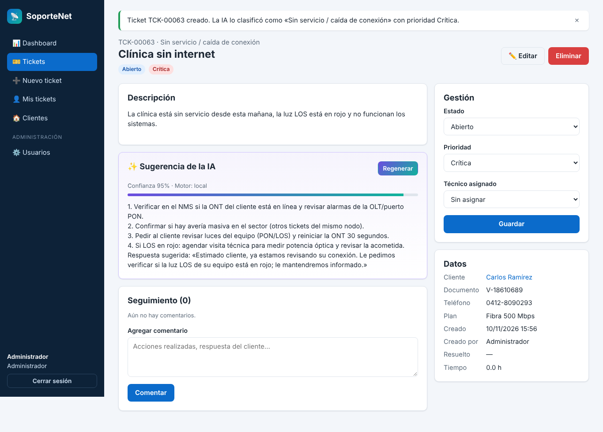

# 📡 SoporteNet — Mesa de ayuda con IA para proveedores de internet

Proyecto final del **Diplomado en Python (Programación Full Stack con Python e Inteligencia Artificial)**.

SoporteNet centraliza los reportes de los clientes de un proveedor de fibra óptica. Usa Inteligencia Artificial para **clasificar** cada ticket, **asignarle una prioridad** y **proponer una solución**, y controla los tiempos de atención (SLA) desde un dashboard.

**Tecnologías:** Python 3.11+, Flask, SQLAlchemy, Alembic, Flask-Login, HTML5, CSS3, JavaScript, Chart.js, PostgreSQL/MySQL/SQLite, Claude API, pytest, Docker y GitHub Actions.



---

## ✨ Funcionalidades

- 🔐 Registro de usuarios e inicio de sesión con roles (administrador, técnico y agente).
- 🎫 CRUD de tickets con filtros, búsqueda y paginación.
- ✨ **IA:** clasificación automática (categoría y prioridad) y sugerencia de solución, con análisis en vivo antes de guardar.
- ⏱️ Control de SLA por prioridad (crítica 4 h, alta 24 h, media 48 h, baja 72 h).
- 💬 Comentarios e historial de cambios de estado.
- 🏠 Gestión de clientes con validación de cédula o RIF.
- 📊 Dashboard con indicadores y gráficos.
- 🔌 API REST JSON.
- ✅ 52 pruebas automatizadas (86 % de cobertura).
- 🐳 Docker + PostgreSQL y CI con GitHub Actions.

## 📸 Capturas

| Nuevo ticket con análisis de IA | Detalle y gestión del ticket |
|---|---|
|  |  |

## 🚀 Instalación local (5 minutos)

```bash
# 1. Crear y activar el entorno virtual
python -m venv .venv
source .venv/bin/activate        # Windows: .venv\Scripts\activate

# 2. Instalar dependencias
pip install -r requirements-dev.txt

# 3. Configurar variables de entorno
cp .env.example .env             # Windows: copy .env.example .env

# 4. Crear la base de datos y cargar datos de demostración
flask db upgrade
flask seed

# 5. Ejecutar
flask run
```

Abre <http://127.0.0.1:5000> e ingresa con uno de estos usuarios:

| Rol | Correo | Contraseña |
|---|---|---|
| Administrador | admin@soportenet.local | admin123 |
| Técnico | andrea@soportenet.local | tecnico123 |
| Agente | laura@soportenet.local | agente123 |

También puedes crear tu propia cuenta desde **«Regístrate»**, en la pantalla de inicio de sesión. Las cuentas nuevas tienen rol de agente, y un administrador puede cambiarlo en **Usuarios**. Para desactivar el registro público, define `REGISTRO_HABILITADO=0`.

## 🤖 Activar la IA con Claude (opcional)

Sin configuración, la app usa un **clasificador local** de procesamiento de lenguaje natural, que no necesita internet. Para usar un modelo de lenguaje real:

1. Crea una clave en <https://console.anthropic.com>.
2. En `.env`, coloca `ANTHROPIC_API_KEY=tu_clave`.
3. Reinicia la app. En el panel de IA aparecerá «Motor: Claude (LLM)».

Si la API falla, el sistema vuelve automáticamente al modelo local.

## 🧪 Pruebas y calidad

```bash
pytest --cov=app          # pruebas + cobertura
ruff check app tests      # linter
```

## 🐳 Docker (con PostgreSQL)

```bash
docker compose up --build
```

La app queda en <http://localhost:8000>. Al arrancar, aplica las migraciones y carga los datos de demostración si la base está vacía.

## ☁️ Despliegue en la nube (Render, Railway, etc.)

1. Sube el repositorio a GitHub.
2. Crea un servicio **Web** de tipo *Docker* y una base de datos **PostgreSQL**.
3. Configura estas variables: `DATABASE_URL`, `SECRET_KEY` (una cadena aleatoria) y, si quieres usar Claude, `ANTHROPIC_API_KEY`.
4. El `Dockerfile` usa la variable `PORT` del proveedor de forma automática.

## 📁 Estructura

```
soportenet/
├── app/
│   ├── __init__.py          # create_app, CSRF, errores, filtros
│   ├── config.py            # configuración por entorno
│   ├── models.py            # Usuario, Cliente, Categoria, Ticket, Comentario
│   ├── cli.py               # flask seed / init-db
│   ├── ia/servicio.py       # clasificador IA (Claude + respaldo local)
│   ├── tickets/             # vistas web + servicios de negocio
│   ├── clientes/  usuarios/  auth/
│   ├── api/routes.py        # API REST
│   ├── templates/           # Jinja2 (HTML5)
│   └── static/              # CSS3, JavaScript, Chart.js
├── migrations/              # Alembic
├── tests/                   # pytest
├── docs/requerimientos.md   # requerimientos, diagrama ER, arquitectura
├── Dockerfile  docker-compose.yml
└── .github/workflows/ci.yml
```

## 🔌 API REST (ejemplo)

```bash
# Con la sesión iniciada en el navegador, o usando una cookie de sesión:
curl -X POST http://127.0.0.1:5000/api/ia/clasificar \
  -H "Content-Type: application/json" \
  -d '{"titulo":"Sin internet","descripcion":"La luz LOS está en rojo desde ayer"}'
```

Consulta todos los endpoints en [`docs/requerimientos.md`](docs/requerimientos.md#10-api-rest).

---

**Autor:** Efrenyer Briceño · Diplomado en Python · UneWeb · 2026
