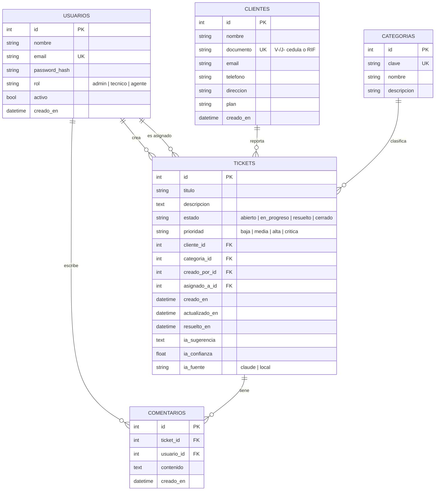
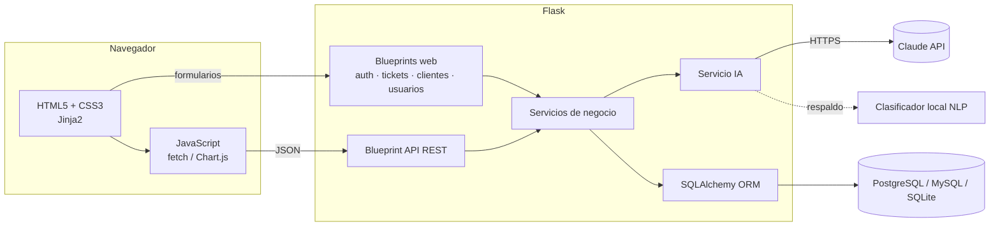

# SoporteNet — Documento de requerimientos y diseño

**Proyecto final · Diplomado en Python (Programación Full Stack con Python e IA) · UneWeb**
**Autor:** Efrenyer Briceño · **Fecha:** noviembre 2026

---

## 1. Planteamiento del problema

En los proveedores de internet por fibra óptica, los reportes de los clientes («no tengo internet», «está lento», «me cobraron doble») llegan por teléfono, WhatsApp y correo. Normalmente se registran en hojas de cálculo o en mensajes sueltos, lo que provoca:

- Casos perdidos o duplicados, sin un responsable claro.
- Prioridades asignadas «a ojo»: una clínica sin servicio puede esperar lo mismo que una consulta de factura.
- Ningún indicador para saber cuánto se tarda en resolver o si se cumplen los tiempos comprometidos (SLA).

## 2. Objetivo general

Desarrollar una aplicación web full stack en Python que centralice la gestión de tickets de soporte técnico y use Inteligencia Artificial para clasificarlos, priorizarlos y proponer una solución.

### Objetivos específicos

1. Diseñar una base de datos relacional normalizada para clientes, usuarios, tickets y comentarios.
2. Construir un backend con Flask, SQLAlchemy y migraciones con Alembic.
3. Desarrollar un frontend responsive con HTML5, CSS3 y JavaScript (DOM, eventos, `fetch` con `async/await`).
4. Exponer una API REST documentada.
5. Integrar un modelo de IA (Claude API) con un clasificador local de respaldo.
6. Garantizar la calidad con pruebas automatizadas (pytest) e integración continua (GitHub Actions).
7. Empaquetar la aplicación con Docker para desplegarla en la nube.

## 3. Alcance

**Incluye:** autenticación con roles, CRUD de clientes y tickets, comentarios de seguimiento, asignación de técnicos, control de SLA, dashboard con indicadores, clasificación con IA, API REST, pruebas y despliegue con Docker.

**No incluye (trabajo futuro):** portal de autogestión para clientes finales, notificaciones por WhatsApp o correo e integración directa con el NMS/OLT.

## 4. Actores y roles

| Rol | Descripción | Permisos |
|---|---|---|
| Administrador | Supervisor del área de soporte | Todo, incluida la gestión de usuarios y la eliminación de registros |
| Técnico | Atiende y resuelve los casos | Crear, editar, gestionar y comentar tickets y clientes |
| Agente | Recibe la llamada del cliente | Crear tickets y clientes, comentar |

## 5. Requerimientos funcionales

| ID | Requerimiento |
|---|---|
| RF-01 | El sistema debe permitir iniciar y cerrar sesión con correo y contraseña. |
| RF-01b | Una persona nueva debe poder registrarse con nombre, correo y contraseña (mín. 8 caracteres, letras y números). La cuenta se crea con rol de agente y el registro puede desactivarse con `REGISTRO_HABILITADO=0`. |
| RF-02 | El administrador debe poder crear usuarios, cambiar su rol y activarlos o desactivarlos. |
| RF-03 | Se debe poder registrar, consultar, editar, buscar y eliminar clientes (con cédula o RIF única y validada). |
| RF-04 | Se debe poder crear un ticket asociado a un cliente, con título y descripción. |
| RF-05 | Al crear un ticket, la IA debe sugerir su **categoría**, su **prioridad** y una **propuesta de solución**. |
| RF-06 | El usuario debe poder consultar el análisis de IA antes de guardar y aceptarlo o corregirlo. |
| RF-07 | Se debe poder cambiar el estado (Abierto → En progreso → Resuelto → Cerrado), la prioridad y el técnico asignado. |
| RF-08 | Cada cambio de estado debe quedar registrado en el historial del ticket. |
| RF-09 | Se deben poder agregar comentarios de seguimiento. |
| RF-10 | El listado de tickets debe permitir filtrar por estado, prioridad, categoría y técnico, y buscar por texto, con paginación. |
| RF-11 | El sistema debe marcar los tickets que superen su SLA (crítica 4 h, alta 24 h, media 48 h, baja 72 h). |
| RF-12 | Un dashboard debe mostrar los indicadores: abiertos, críticos, SLA vencido, tiempo promedio de resolución y cumplimiento de SLA, además de gráficos. |
| RF-13 | El sistema debe exponer una API REST JSON para tickets, clientes, clasificación con IA y estadísticas. |

## 6. Requerimientos no funcionales

| ID | Requerimiento |
|---|---|
| RNF-01 | **Seguridad:** contraseñas con hash (PBKDF2/scrypt de Werkzeug), protección CSRF en formularios, control de acceso por rol y prevención de *open redirect*. |
| RNF-02 | **Disponibilidad de la IA:** si la API externa falla o no está configurada, el sistema usa un clasificador local sin interrumpir el servicio. |
| RNF-03 | **Portabilidad:** funciona con SQLite (desarrollo), PostgreSQL o MySQL (producción) sin cambiar el código. |
| RNF-04 | **Usabilidad:** interfaz responsive (móvil y escritorio) con modo oscuro automático. |
| RNF-05 | **Calidad:** cobertura de pruebas de al menos 80 % verificada en CI. |
| RNF-06 | **Despliegue:** imagen Docker reproducible y ejecución con Gunicorn. |

## 7. Modelo de datos (diagrama entidad-relación)

**Integridad referencial:** al eliminar un cliente se eliminan sus tickets (`ON DELETE CASCADE`), y al eliminar un ticket se eliminan sus comentarios.

## 8. Arquitectura

- **Patrón Application Factory** (`create_app`) con configuración por entorno.
- **Blueprints** que separan los módulos.
- **Capa de servicios** (`tickets/servicios.py`) compartida por la web y la API, sin duplicar lógica.
- **Servicio de IA** desacoplado: puede cambiarse el proveedor sin tocar las vistas.

## 9. Funcionamiento de la IA

1. Se envían el título y la descripción a Claude con un *prompt* de sistema que define las categorías y prioridades válidas, y se exige una respuesta en JSON.
2. Se valida que la categoría y la prioridad pertenezcan al catálogo. Si no, se descarta la respuesta.
3. **Respaldo local:** el texto se normaliza (minúsculas, sin acentos), se puntúa por palabras clave con pesos por categoría y se detecta la urgencia («empresa», «clínica», «toda la zona» → crítica; «desde ayer», «teletrabajo» → alta; «consulta», «duda» → baja). La confianza se calcula según qué tan dominante es la categoría ganadora.
4. La sugerencia incluye pasos técnicos propios de redes FTTH (potencia óptica, ONT/OLT, LOS) y una respuesta sugerida para el cliente.

## 10. API REST

| Método | Ruta | Descripción |
|---|---|---|
| GET | `/api/salud` | Verificación de estado (sin autenticación) |
| GET | `/api/tickets?estado=&prioridad=&categoria=&q=&pagina=` | Listar y filtrar |
| POST | `/api/tickets` | Crear (la IA clasifica) |
| GET | `/api/tickets/<id>` | Detalle con comentarios y análisis de IA |
| PATCH | `/api/tickets/<id>` | Actualizar estado, prioridad, asignación, etc. |
| DELETE | `/api/tickets/<id>` | Eliminar (solo administrador) |
| POST | `/api/tickets/<id>/comentarios` | Agregar un comentario |
| GET | `/api/clientes` | Listar clientes |
| POST | `/api/ia/clasificar` | Clasificar un texto sin guardarlo |
| GET | `/api/estadisticas` | Indicadores del dashboard |

## 11. Plan de pruebas

| Tipo | Archivo | Qué se verifica |
|---|---|---|
| Unitarias de IA | `tests/test_ia.py` | Categorías, prioridades, normalización, respaldo cuando falla el LLM (con *mock*) |
| Unitarias de modelos | `tests/test_modelos.py` | Hash de contraseñas, código del ticket, SLA, cambio de estado, eliminación en cascada |
| Integración de API | `tests/test_api.py` | Autenticación, CRUD, validaciones, permisos, filtros y estadísticas |
| Funcionales web | `tests/test_web.py` | Login, flujo completo de un ticket, CRUD de clientes, roles, CSRF, 404 |
| Registro | `tests/test_registro.py` | Registro exitoso, validaciones, rol forzado a agente, registro deshabilitado, cambio de rol |

Resultado: **52 pruebas exitosas, 86 % de cobertura.**

## 12. Relación con los módulos del diplomado

| Módulo | Aplicación en el proyecto |
|---|---|
| 1 · Lógica de programación | Algoritmo de puntuación del clasificador, reglas de SLA |
| 2–3 · HTML5 y CSS3 | Plantillas semánticas, Flexbox/Grid, variables CSS, diseño responsive, animaciones con *keyframes* |
| 4–5 · JavaScript | DOM, eventos, `fetch` con `async/await`, manejo de errores, Chart.js |
| 6–7 · MySQL y PostgreSQL | Modelo relacional, claves foráneas, `CASCADE`, índices; PostgreSQL en Docker |
| 8 · Python I | POO (modelos, *dataclass* `ResultadoIA`), módulos, diccionarios y estructuras de control |
| 10 · Flask | Blueprints, plantillas, sesiones, SQLAlchemy, Alembic, API REST |
| 12 · Testing y despliegue | pytest, cobertura, ruff, entorno virtual, Docker, GitHub Actions |
| 13 · IA para programadores | Integración con la API de Claude, *prompt engineering* y respaldo local |
| 14 · Proyecto | Requerimientos, diseño, desarrollo, pruebas, IA y despliegue |
